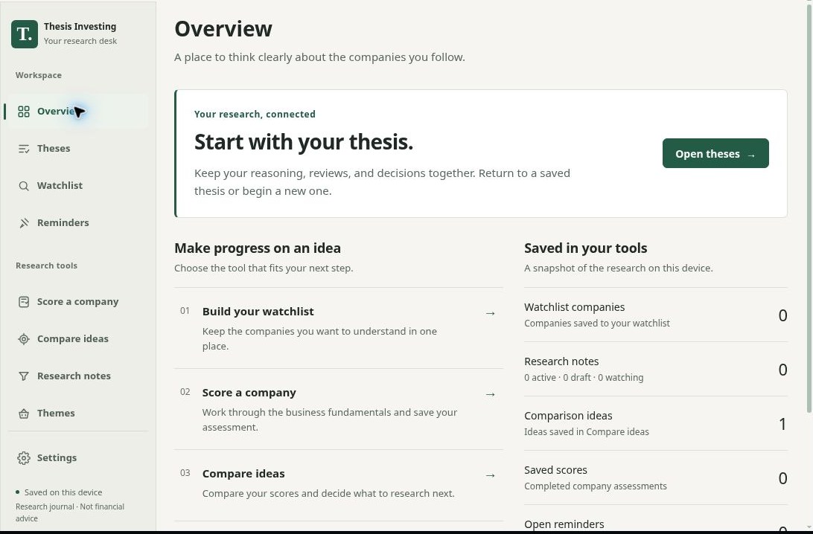
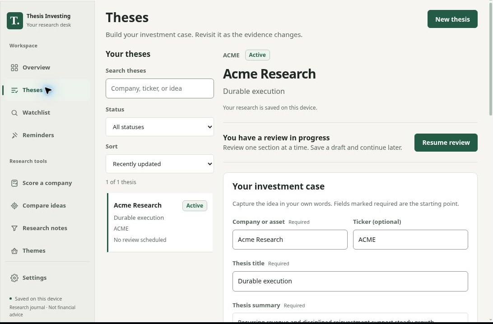

# Thesis Investing

A Windows desktop app for investors who want to think before they trade. Score a company on its fundamentals, write down *why* you own it, and come back on a schedule to check whether that reason still holds.

Everything is stored locally in SQLite. No account, no brokerage connection, no live market data, nothing leaves your machine.

[](https://github.com/LichaWeComeThere/thesis-investing/actions/workflows/ci.yml)




## Why

Most retail investing mistakes aren't bad picks; they're forgotten reasons. You buy a stock for a thesis, the price moves, and six months later you can't remember what you were betting on. Thesis Investing is a research journal with structure: it forces the thesis into writing, scores the business the same way every time, and keeps an immutable record of every review and decision so you can see your own reasoning drift.

## What it does

| Area | What you can do |
| --- | --- |
| **Score a company** | Walk through a manual business-quality scorecard (the MBS score) and save a snapshot. Rescore later and compare. |
| **Compare ideas** | Rank saved scores against each other to decide what to research next. |
| **Theses** | Write an investment case per company: summary, structured risks and catalysts, status. The "Living Thesis" is the center of the app. |
| **Guided reviews** | Revisit a thesis section by section, preview proposed edits, save a draft, or complete the review. Completed reviews are immutable revisions. |
| **Decision log** | Record buy / hold / trim / sell decisions with reasoning, optionally linked to a review. |
| **History** | One timeline per thesis: reviews, decisions, and score changes, newest first. |
| **Thesis health** | A local assessment that flags recorded high risks and falling scores, and says plainly when it doesn't have enough information. |
| **Review queue** | See which theses are due or overdue for a review. |
| **Watchlist, themes, reminders** | Track companies you're not ready to score, group ideas into theme baskets, and set manual reminders (earnings dates, follow-ups). |
| **Backups** | Export everything to a versioned JSON file and import it back with a preview-first, append-only import. Older export formats stay readable. |



## Tech stack

- **Electron 44** desktop shell with a hardened main/preload/renderer split (context isolation, IPC allow-list, encrypted key storage via the OS credential store)
- **React 18 + TypeScript** renderer, built with **Vite** / electron-vite
- **SQLite** for local persistence, with versioned migrations and a verified runtime check inside Electron
- **pnpm workspaces** monorepo: domain logic is a pure TypeScript package with its own tests, shared UI is a separate package, the app is a thin shell on top
- **Vitest** unit tests, **ESLint** + strict TypeScript, **GitHub Actions** CI on every pull request

## Run it locally

Requirements: Node.js 22.12+ and pnpm 9.15.4 (`corepack enable` installs the pinned version).

```bash
pnpm install
pnpm dev          # launches the Electron app; first run downloads Electron
```

Other scripts:

```bash
pnpm lint             # ESLint
pnpm typecheck        # tsc across all workspaces
pnpm test             # Vitest across all workspaces
pnpm build            # build all workspaces
pnpm package:windows  # unpacked Windows build in apps/desktop/release/windows
pnpm verify:storage   # SQLite-inside-Electron runtime check
pnpm verify:desktop   # automated Electron smoke test (IPC protections, key storage)
pnpm preview:review   # browser preview of the review UI with fictional sample data
```

## How the code is organized

```
apps/desktop/     Electron + React app (main process, preload, renderer, SQLite layer)
packages/core/    Pure TypeScript domain logic: scoring, ranking, thesis model, review rules
packages/ui/      Reusable React components and the design system
docs/             Feature specs, architecture notes, release and QA docs
tools/            Development helpers (review UI preview server)
```

The rule that shaped the architecture: **anything that computes lives in `packages/core` and has no idea Electron exists.** The desktop app only wires storage and screens to it. That keeps the scoring and review logic unit-testable and lets the review UI run in a plain browser for design work.

## Status

The app is feature-complete for local, offline use: scoring, ranking, theses, guided reviews, decision log, history, health assessment, review queue, backups. Current work is manual Windows acceptance testing ahead of a first packaged release.

Planned next, in order: a packaged Windows installer, read-only market data (prices and filings, still no trading), and later an optional AI research assistant. See the [roadmap](docs/ROADMAP.md).

Not planned: brokerage connections, trade execution, personalized advice, cloud sync.

## Documentation

Start with [Architecture](docs/ARCHITECTURE.md) and [Domain models](docs/DOMAIN_MODELS.md). Feature-level specs:

- Scoring and ranking: [MBS scoring](docs/MBS_SCORING.md) · [Manual scorer screen](docs/MANUAL_MBS_SCORER.md) · [Portfolio ranker](docs/PORTFOLIO_RANKER.md)
- Living Thesis: [Architecture](docs/LIVING_THESIS_ARCHITECTURE.md) · [Library](docs/LIVING_THESIS_LIBRARY.md) · [Review workflow](docs/LIVING_THESIS_REVIEW_WORKFLOW.md) · [Review session storage](docs/LIVING_THESIS_REVIEW_SESSION_STORAGE.md) · [Guided review UI](docs/LIVING_THESIS_REVIEW_SESSION_UI.md) · [Decision log](docs/LIVING_THESIS_DECISION_LOG.md) · [History](docs/LIVING_THESIS_HISTORY.md) · [Health](docs/LIVING_THESIS_HEALTH.md) · [Review queue](docs/LIVING_THESIS_REVIEW_QUEUE.md)
- Other screens: [Dashboard](docs/DASHBOARD.md) · [Watchlist](docs/WATCHLIST.md) · [Theme baskets](docs/THEME_BASKETS.md) · [Reminders](docs/REMINDERS.md) · [Onboarding](docs/ONBOARDING.md) · [Thesis monitor](docs/THESIS_MONITOR.md) · [Company details](docs/COMPANY_DETAILS.md)
- Data: [Persistence](docs/PERSISTENCE.md) · [Export](docs/LOCAL_DATA_EXPORT.md) · [Import](docs/LOCAL_DATA_IMPORT.md) · [Maintenance](docs/LOCAL_DATA_MAINTENANCE.md) · [Storage runtime verification](docs/STORAGE_RUNTIME_VERIFICATION.md) · [Data connection foundation](docs/DATA_CONNECTION_FOUNDATION.md)
- Design and release: [Design system](docs/DESIGN_SYSTEM.md) · [UI redesign](docs/UI_REDESIGN.md) · [Windows release](docs/WINDOWS_RELEASE.md) · [Release smoke test](docs/RELEASE_SMOKE_TEST.md) · [Electron upgrade](docs/ELECTRON_UPGRADE.md)
- Process and history: [Roadmap](docs/ROADMAP.md) · [Phase 1 closeout](docs/PHASE_1_CLOSEOUT.md) · [Phase 2 closeout](docs/PHASE_2_CLOSEOUT.md) · [Living Thesis closeout](docs/LIVING_THESIS_CLOSEOUT.md) · [Archive](docs/archive/README.md)
- Contributor notes: [docs/dev](docs/dev) (definition of done, issue labels, design QA log, AI-assisted workflow notes)

## How it was built

Built in small pull requests, one feature stage at a time, each with its own spec in `docs/` and a QA pass before merging. Manuel Diaz ([@LichaWeComeThere](https://github.com/LichaWeComeThere)) led the project: product direction, architecture, the Living Thesis review workflow, data model, and QA. [@Itsnick141](https://github.com/Itsnick141) contributed to the desktop UI, including the tab layout, Thesis Board, and ranking screens. AI coding tools were used as a pair programmer throughout; the process notes in [docs/dev](docs/dev) show how the work was staged.

## Disclaimer

Thesis Investing is educational software and a personal research tool. It is not financial advice, investment advice, a brokerage, or a trading platform.

## License

[MIT](LICENSE) © 2026 Manuel Diaz
